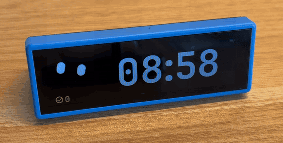
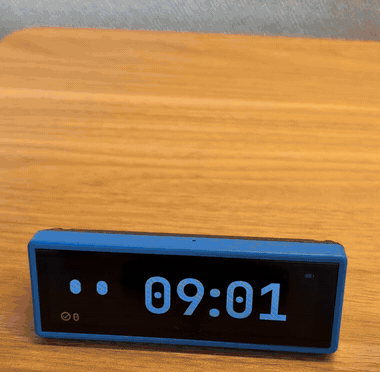
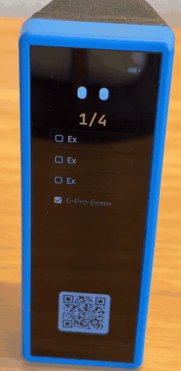
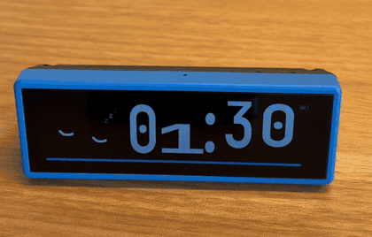
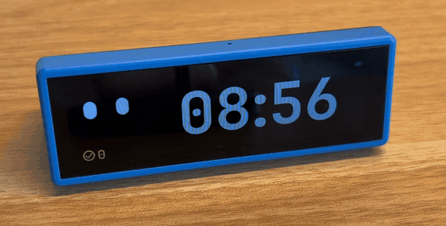

# Chibi

**A little desk buddy that turns studying into a game.**

Chibi is a small clock with a face. You don't press buttons to use it. You **turn it over**:
lay it down to see the time, flip it to start studying, stand it up to see your to-do list, and
turn it upside down to slash the tasks you finished. A small character lives on the screen and
reacts to all of it. It cheers when you finish, naps on your breaks, and gets an umbrella out
when it's going to rain.

  

I built Chibi because studying is easier to start when it feels like a game. Flipping the
device over *is* the "start" button. Finishing a session earns a break. Checking off tasks and
clearing them gives you combos and a big "ultimate" for clearing five at once.

---

## See it in action

| Study: flip it over | Tasks: tap to check off, then flip to clear |
|:---:|:---:|
|  |  |
| **Break: the character naps** | **Home: the character looks around** |
|  |  |

A full one-minute walkthrough (shown at 2× speed) is in [docs/media/tour.mp4](docs/media/tour.mp4).

You can also **try it without any hardware**: the [browser simulator](simulator/) runs the real
firmware in a web page.

---

## How you use it

| Turn it so it's… | You get | What happens |
|---|---|---|
| Lying on its long side | **Home** | The time, how many sessions you've done today, and the character. |
| Flipped over (upside down) | **Study** | A countdown starts (25 minutes by default). Tap to pause, double-tap to restart. |
| Back to Home after a session | **Break** | The character naps while a break counts down (5 minutes by default). |
| Standing up | **Tasks** | Your to-do list and a QR code. Tap a task to check it off. |
| Standing upside down | **Clear** | Every checked task gets slashed: one is a *slash*, 2–3 a *combo*, 4 or more the *ultimate*. |

Scan the QR code with your phone to add, rename and reorder tasks, change the text size, and
set up the rain forecast. Knock on the desk twice, pause, then once (●● ●) to put it in **carry
mode** for your bag.

The full guide is in **[docs/USING.md](docs/USING.md)**.

---

## Make your own

You need:

- A **[Waveshare ESP32-S3-Touch-LCD-3.49](https://www.waveshare.com/esp32-s3-touch-lcd-3.49.htm)**
  board. It has the screen, touch, motion sensor, clock chip and battery charger built in, so
  there's **no soldering**.
- The **3D-printed back case** from [`hardware/case/`](hardware/case/).
- A USB-C cable, and optionally a battery.

Then:

1. **Print the case:** [hardware/README.md](hardware/README.md).
2. **Put the firmware on the board** straight from your browser, with nothing to install.
   The steps are in [docs/BUILDING.md](docs/BUILDING.md#2-put-the-firmware-on-the-board), and
   the ready-made files are in [`prebuilt/`](prebuilt/).
3. **Optional, change the code:** build it yourself with ESP-IDF, also in
   [docs/BUILDING.md](docs/BUILDING.md#3-build-it-yourself-optional).

---

## What's in this repository

| Folder | What it is |
|---|---|
| [`firmware/`](firmware/) | The source code that runs on the board (C, ESP-IDF 5.5.3, LVGL 9.2.2). |
| [`firmware/main/web/index.html`](firmware/main/web/index.html) | The phone page you open from the QR code. |
| [`prebuilt/`](prebuilt/) | Ready-to-flash firmware files, so you don't have to build anything. |
| [`hardware/`](hardware/) | The 3D-printable back case (STEP and STL). |
| [`simulator/`](simulator/) | The real firmware compiled for the browser. Try it or test changes without a board. |
| [`docs/`](docs/) | The user guide, the build guide and how the code works. |

## Learn more

- **[docs/USING.md](docs/USING.md)**: everything the device can do, plus troubleshooting.
- **[docs/BUILDING.md](docs/BUILDING.md)**: printing, flashing and building from source.
- **[docs/HOW_IT_WORKS.md](docs/HOW_IT_WORKS.md)**: how the code is organised, for anyone who wants to change it.

## Privacy

Chibi has no account, no cloud and no app. Your tasks stay on the device. The phone page is
served by the device itself. The only time it goes online is to check the rain forecast and set
the clock, and only if you give it your home Wi-Fi. The details are in
[docs/USING.md](docs/USING.md#weather).

## License

The code and the case are released under the [MIT License](LICENSE). Libraries and fonts that
come with it keep their own licenses. See [THIRD_PARTY_NOTICES.md](THIRD_PARTY_NOTICES.md).
