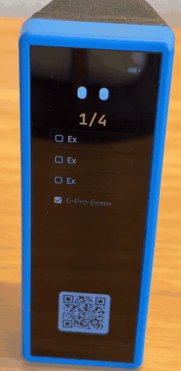

# Using Chibi

Chibi is controlled mostly by **how you turn it**. There are two buttons on the side
(**BOOT** and **PWR**), a touch screen, and a phone page for the things that are easier to type.

- [The four positions](#the-four-positions)
- [Studying and breaks](#studying-and-breaks)
- [Tasks and clearing them](#tasks-and-clearing-them)
- [Carry mode (knock ●● ●)](#carry-mode)
- [Buttons](#buttons)
- [Settings](#settings)
- [The phone page](#the-phone-page)
- [Weather](#weather)
- [Battery, charging and the screen](#battery-charging-and-the-screen)
- [Troubleshooting](#troubleshooting)

---

## The four positions

| Position | Screen | What you see |
|---|---|---|
| Lying on its long side | **Home** | The time, the number of study sessions finished today, and the character. If a study is paused, it shows the time left. |
| The same, flipped over | **Study** | The study countdown, the task you're on, and the character reading. |
| Standing up | **Tasks** | Your to-do list, how many are done (e.g. `2/4`), and a QR code for the phone page. |
| Standing upside down | **Clear** | The checked tasks get slashed off the list. |

The device notices a new position after you've held it there for about half a second, so
picking it up and putting it down again doesn't change anything.

> **The screen is upside down, or the wrong screen shows?** Every board sits a little
> differently in its case. Run **Settings › Direction** once (see [Settings](#settings)) and
> it will learn your device's four positions.

---

## Studying and breaks

1. **Flip Chibi over** to start a study session. The countdown starts as soon as the digits
   have landed. The default length is 25 minutes, and you can change it in [Settings](#settings).
2. While studying:
   - **Tap** the screen to pause or resume.
   - **Double-tap** to restart the countdown from the full length.
   - **Hold** the screen for about 1 second to end the session.
3. **When the time is up**, the character celebrates and the session counts toward today's
   total on Home.
4. **Turn it back to Home to take your break.** The character naps while the break counts down
   (5 minutes by default).
   - A finished session earns the **full break**. If you stop early (after at least 1 minute of
     studying), you get **half a break**, once per session.
   - Taps do nothing during a break, so it can't be stretched.
   - Flipping back to Study ends the break straight away.
   - Holding the screen for 1 second ends the whole session.
   - To skip the break, tap the celebration screen or press **BOOT** before you turn it.

If you turn away from Study in the middle of a session, the session is **paused**, and Home
shows the time left. Flip back to carry on.

The session counter on Home goes back to 0 at midnight.

---

## Tasks and clearing them

**Stand Chibi up** to see your list.

- **Tap a task** to check it off (or un-check it).
- Scroll the list with your finger if it's longer than the screen.
- Use the phone page (scan the QR code) to add, rename, reorder or delete tasks, and to make
  the text bigger.

**Stand it upside down** to clear every checked task. The more you clear at once, the bigger
the effect:

| Checked tasks | Effect |
|---|---|
| 1 | **Slash** |
| 2–3 | **Combo** |
| 4 or more | **Ultimate**: the screen darkens, the character powers up, and everything is cut at once. |

Unchecked tasks stay on the list.



---

## Carry mode

Putting Chibi in a bag would normally flip it between screens all the time. **Carry mode**
freezes everything:

- **To turn it on**, knock on the desk next to it: **two quick knocks, a short pause, then one
  more** (●● ●). Knock firmly with a knuckle, not the side of your hand.
- Timers stop, the position is ignored, and the character goes into its little house. After a
  minute in carry mode with Wi-Fi off, it goes into a deep sleep (screen off) to save battery.
- **To turn it off**, knock ●● ● again, or press **BOOT**.

Picking it up, turning it or putting it down doesn't count as knocks. Knocks are only counted
when the device is still and hasn't just been turned.

---

## Buttons

| Button | Press | Hold |
|---|---|---|
| **BOOT** | Ends carry mode. In Settings: next page. On the celebration screen: skip the break. | About 1 second: open Settings. Hold again to save and close. |
| **PWR** | Turns the screen off. If no timer is running and Wi-Fi is off, it goes into a deep sleep instead. | 3 seconds: power off (on battery). |

To wake it from a deep sleep, press **PWR** or pick it up.

---

## Settings

**Hold BOOT** for about a second to open Settings. Press **BOOT** to go to the next page, and
use the on-screen buttons to change a value. **Hold BOOT** again to save and close. Settings
also close by themselves after 20 seconds without a touch. Timers are frozen while Settings
are open.

| Page | What it sets |
|---|---|
| **Study length** | 15, 20, 25, 30, 35, 40, 45, 50 or 60 minutes |
| **Break length** | 3, 5, 10, 15 or 20 minutes |
| **Brightness** | Screen brightness in 10 % steps |
| **Direction** | Teaches Chibi which way is which. Tap ▶ and follow the four steps: each time, turn the device until the arrow points up and the text reads upright, then hold it still for about a second. A ✓ shows when it's done. |

If you change a length while a timer is running, the time already spent is kept.

---

## The phone page

Stand Chibi up and **scan the QR code** with your phone camera.

- **If Chibi doesn't know your Wi-Fi**, it makes its own network called `Chibi-XXXX`. The QR
  code joins it, and the phone page opens on its own (the "sign in to network" page).
  If it doesn't open, go to **`http://192.168.4.1`** in your browser.
- **If you've saved your home Wi-Fi** and it's in range, Chibi joins it, and the QR code is a
  link to the page instead. That link contains a private key, so only people who can see the
  screen can open it.

On the page you can:

- **Add** tasks, **tap** one to rename it, **hold and drag** to reorder, **swipe left** to delete.
  Japanese tasks work too.
- Tap **Aa** to change the **text size** of the task list on the device. The preview shows
  exactly how the device will cut long names, and the device updates while you slide.
- Open **Weather** to set up the rain forecast and save Wi-Fi networks (below).
- The device clock is set from your phone automatically when you open the page.

To save battery, Wi-Fi turns off 5 minutes after you leave the Tasks screen, or after 10
minutes on Tasks with nobody using the page or touching the device. **Touch the Tasks screen**
(or stand it up again) to bring it back. The page itself stops checking in after 5 minutes
without a tap, so a page left open on your phone doesn't keep Wi-Fi on; tap it to carry on.

---

## Weather

If you give Chibi your home Wi-Fi, it can show whether it's going to rain today. When rain is
coming, the character holds an umbrella, and it rains (or snows) on the Home screen.

1. Open the phone page and tap **Weather**.
2. Under **Wi-Fi networks**, tap **+ Add a network**. Pick yours from **Nearby**, or choose
   **Type the name** (for example for a phone hotspot that's switched off right now). Enter the
   password and tap **Add network**. You can save up to 3 networks.
   - The label next to each saved network tells you how it went: **Connects ✓**,
     **Saved · not nearby now**, or **Wrong password** (tap **Fix password**).
3. Under **Place**, choose **Near me** (worked out from your internet connection) or
   **Choose a place** and type a city.
4. Tap **Save**.

About once an hour, Chibi joins your Wi-Fi for a few seconds, fetches the forecast, sets its
clock, and turns Wi-Fi off again. The forecast comes from
[Open-Meteo](https://open-meteo.com) (free, no account). For **Near me**, the approximate
location comes from [ipinfo.io](https://ipinfo.io) (or [ipapi.co](https://ipapi.co) as a
backup). Nothing else leaves the device.

---

## Battery, charging and the screen

- The small **battery icon** in the corner turns **green while charging** over USB and
  **amber at 15 % or less**.
- If you leave Chibi alone for 90 seconds, the screen **dims to about 10 %** but keeps showing
  everything. To save battery, the character holds still and blinks about once a minute,
  and the rain stops. Any touch, turn or knock brings it back. The screen only turns fully off in
  carry mode, or when you press PWR.
- On a nearly empty battery, it shows a low-battery icon and switches itself off safely.

### Where does the battery go?

Chibi counts how it spent its time on battery: on each screen, with Wi-Fi on, and with the
screen lit or dimmed. There are two ways to see it.

**On a computer (easiest).** Plug Chibi in and open a [serial console](#seeing-what-the-device-is-doing-serial-log).
Plugging in pauses the count, and every 30 seconds Chibi prints a report like this:

```
battery: time on battery : 6.5 h (of which 0.2 h in deep sleep)
battery: Wi-Fi on        : 12% of the time (hotspot 0%)
battery: screen          : bright 30% (at 40% brightness), dimmed 70%, off 0%
battery: screens         : home 60% study 30% tasks 10%
battery: battery         : 4150 mV (100%) -> 3800 mV (52%)
battery: full charge     : about 13 h at this rate
```

Unplugging within 10 minutes carries on with the same count. Staying plugged in longer counts
as charging, and the next unplug starts a new count.

**On your phone.** Open the phone page and add **`api/diag`** right after the first `/` of the
address, keeping anything that comes after it. On the hotspot that's
`http://192.168.4.1/api/diag`; on home Wi-Fi it looks like `http://192.168.1.23/api/diag?t=…`.
The `"battery"` part has the same numbers.

The "full charge" estimate appears once about 8 % of the battery has been used. Switching
Chibi off with a long press of **PWR**, or letting the battery run out, loses the count.

---

## Troubleshooting

| Problem | What to try |
|---|---|
| The wrong screen shows, or a screen is upside down | Run **Settings › Direction** once. |
| The phone page doesn't open after scanning the QR code | Go to `http://192.168.4.1` in your browser. On an iPhone, open **Settings › Wi-Fi › ⓘ** next to `Chibi-XXXX` and turn **Auto-Login** on, or tap **Forget This Network** and scan again. On Android, look for a **"Sign in to Wi-Fi network"** notification. |
| Knocks aren't noticed | Put the device down and wait a second, then knock firmly on the desk right next to it: two quick knocks, a pause of about half a second, then one more. |
| Carry mode turns on by itself | Please open an issue on GitHub and include the serial log lines that mention `knock`. |
| The QR code is gone on the Tasks screen | Wi-Fi went off to save battery. Touch the screen to turn it back on. |
| The clock is wrong | Open the phone page once, and the clock is set from your phone. |

### Seeing what the device is doing (serial log)

Connect the board over USB and open a serial monitor at 115200 baud:

- the **ESP-IDF monitor** (`idf.py monitor`, see [BUILDING.md](BUILDING.md)), or
- the **Console** button on the
  [esptool-js web page](https://espressif.github.io/esptool-js/).

Every 5 seconds the log prints the screen, its frames per second and timings. It also explains
knocks, Wi-Fi checks and what the phone asked for when it joined. Paste these lines when you
report a problem.
