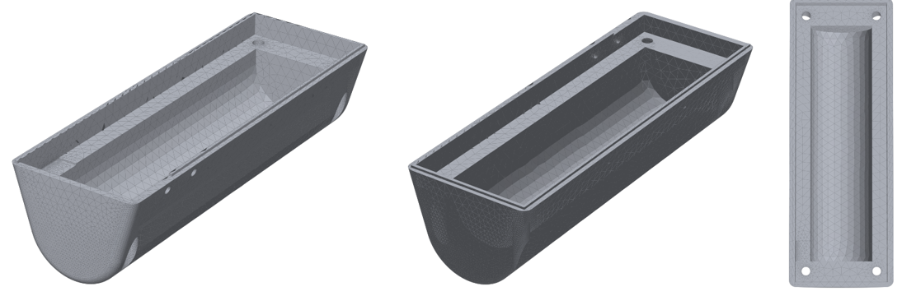

# Hardware

Chibi uses one off-the-shelf board and one 3D-printed part, with no wiring or soldering.

## The board

**Waveshare ESP32-S3-Touch-LCD-3.49**
([product page](https://www.waveshare.com/esp32-s3-touch-lcd-3.49.htm)). Everything Chibi uses
is already on it:

| Part | Used for |
|---|---|
| ESP32-S3 with 16 MB flash and PSRAM | Runs the firmware, Wi-Fi |
| 3.49" 640×172 IPS touch screen (AXS15231B) | The screen and touch |
| QMI8658 motion sensor | Which way it's facing, knocks, waking up when picked up |
| PCF85063 real-time clock | Keeps the time |
| Battery charger and connector | Optional battery |
| BOOT and PWR buttons | Settings, carry mode, screen off, power |

There are two revisions (V1 and V2 / Rev1.1). The firmware supports both. See
[BUILDING.md](../docs/BUILDING.md#1-parts-and-the-case).

## The back case

| File | Use it for |
|---|---|
| [`case/chibi-back-case.step`](case/chibi-back-case.step) | Editing the design in any CAD program (Fusion, FreeCAD, Onshape…). Most slicers can open it too. |
| [`case/chibi-back-case.stl`](case/chibi-back-case.stl) | Printing. Open it in your slicer (PrusaSlicer, Bambu Studio, Cura…). |

- **Size:** about 98 × 35 × 28 mm, as one solid part.
- **Shape:** an open box with a rounded back and four screw holes at the corners.

### Printing tips

These are general suggestions; any common filament and printer should work.

- PLA or PETG, 0.2 mm layers, 15–20 % infill.
- The rounded back is an overhang whichever way up you print it, so turn on supports in your
  slicer.
- Check that the screw holes are clear before assembling.
